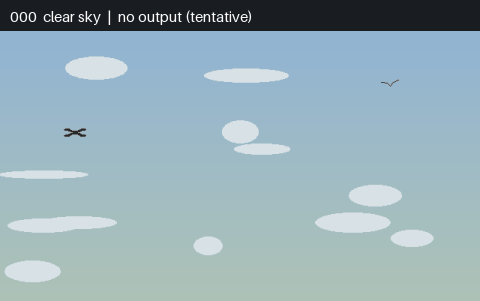
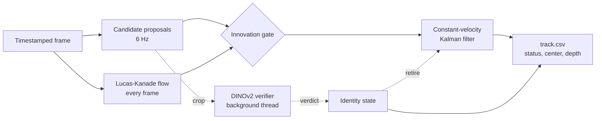
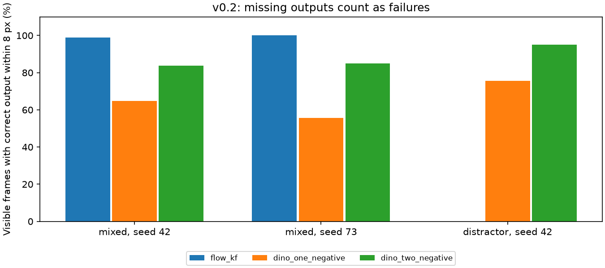
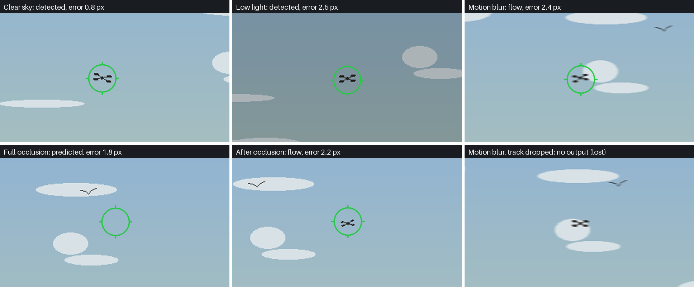
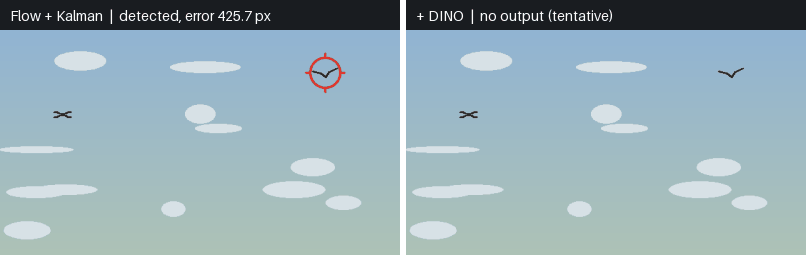
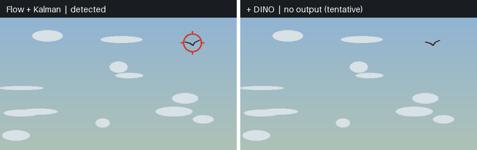
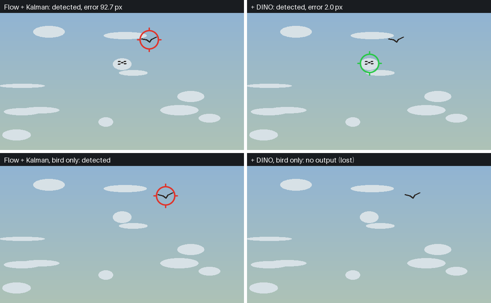
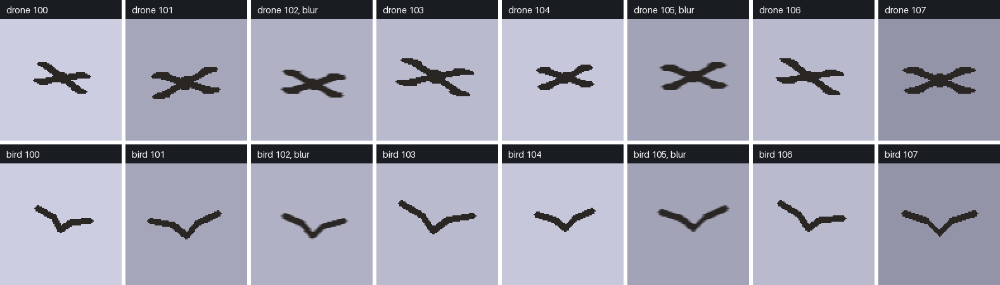
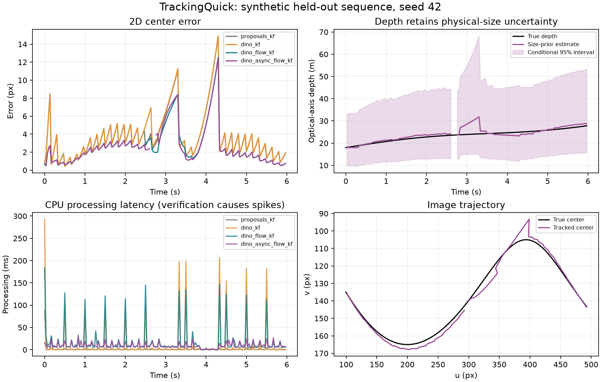
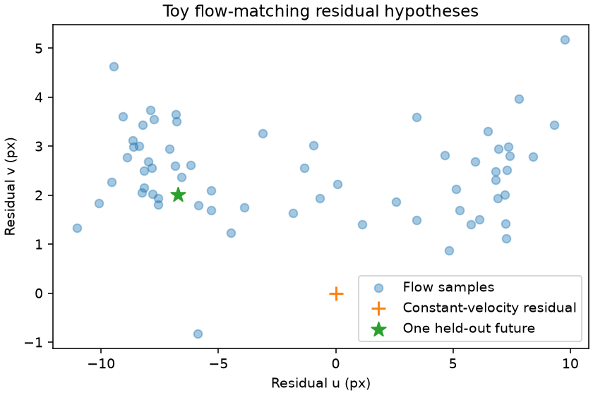

# TrackingQuick

A CPU pipeline for tracking a single drone in video, combining
**DINOv2 appearance verification, Lucas-Kanade point tracking and Kalman filtering**.
It produces image-space trajectories, track status and timing measurements, with
optional depth estimates based on a physical-size prior.

Version 0.2 supports fixed-camera video with a user-specified initial target box,
controlled synthetic evaluation and [evaluation on real footage](#real-footage-evaluation).
The [system outline](OUTLINE.md) describes the proposed extension to calibrated
3D tracking.



*Recorded output of the retire-after-two-negatives policy on mixed clip 42, played
at the clip's 30 Hz timing with every second frame shown. The track holds through
low light and a full occlusion, but is dropped during motion blur and reacquired.
This clip scores 83.6% in the table below.*

## Setup

Python 3.12+ and [uv](https://docs.astral.sh/uv/):

```powershell
uv sync --locked --extra research
uv run python scripts/fetch_dino.py
uv run pytest -q
```

DINOv2-small uses a 24.4 MB INT8 ONNX export with CPU inference. The downloader
verifies the pinned SHA-256 and reuses existing verified weights. Dependency
versions are recorded in `uv.lock`.

## Processing videos

The first command exports a frame for target selection. The second initializes
tracking from a bounding box specified as `X Y WIDTH HEIGHT` in original pixels:

```powershell
uv run trackingquick-video data/drone.mp4 --output runs/drone
# Replace the example coordinates with the target's first-frame bounding box.
uv run trackingquick-video data/drone.mp4 --output runs/drone --roi 84 125 32 20 --max-frames 300
```

| Output | Contents |
| --- | --- |
| `first_frame.jpg`, `inspection.json` | Target-selection frame and video dimensions/fps |
| `track.csv` | Source timestamps, track status, center, optional depth, verification age and timing |
| `manifest.json` | Configuration, initial box, setup time, timestamp fallback and verifier statistics |
| `annotated.mp4` | Tracking overlay, enabled with `--write-video` |

Each source frame produces one CSV row. Confirmed tracks emit coordinates;
other rows retain blank position fields. Status distinguishes detections, flow
updates, predictions, tentative tracks and loss. `--mode flow` selects the
point-flow/Kalman baseline. The default `--negative-limit 1` retires a track after
one negative DINO verdict; `--negative-limit 2` retains it through one negative
verdict with `suspect` status. Positive verification has a finite lifetime.

Optional depth requires both `--focal-px` and `--width-m`. Camera-relative X/Y use
an image-center principal point. Depth estimates are conditional on these camera
and size assumptions.

## Architecture



Proposals find candidates, point flow carries the target between proposals, the
Kalman filter fuses both, and DINO decides whether the tracked object is still
the target. Solid paths run on the frame loop. Dotted paths are asynchronous.

### Design decisions

| Decision | Reasoning |
| --- | --- |
| Separate proposal, motion and identity stages | Each stage fails differently and can be replaced independently. A trained detector can replace the proposal step without changing track logic. |
| Foreground proposals instead of a trained detector | MOG2 suits a fixed camera, is cheap and needs no labelled training set. It finds moving objects only, so identity is left to the verifier. |
| Proposal limits scaled to the target | A fixed minimum size drops distant drones, while loose limits split close ones into fragments. Scaling from the initial box handles both. |
| Linear probe on frozen DINO features | A probe needs few labelled crops and trains in seconds on a CPU. Unlike a single mean prototype, it can separate several kinds of negative. |
| Real false proposals as training negatives | The verifier is shown the crops it will actually have to reject, such as moving vegetation. |
| Block split within class and distance bin | Neighbouring clips can share a session, so random splitting would leak appearance between training and test. |
| External dataset for testing only | Different cameras, sites and aircraft test generalization, and its share-alike license does not extend to the trained verifier. |
| CPU inference with DINOv2-small INT8 through ONNX Runtime | The system should run without a GPU. A frozen backbone needs only a few reference crops and no training loop. |
| 112 px DINO crops | Median crop time was 493.6 ms at 224 px and 108.0 ms at 112 px in the v0.1 runs. This was measured on a loaded laptop, so it is a practical comparison rather than a controlled one. |
| Asynchronous verification, one crop in flight | Crop inference (p95 98.5–126.6 ms) exceeds the 33 ms frame period. A single slot means requests are skipped while the worker is busy, so no backlog can form. |
| Lucas-Kanade flow between proposals | It is inexpensive and keeps the track updating between 6 Hz proposals. TAPNext is the candidate replacement, but its 984 MB ONNX export could not be stored on the evaluation machine, so it has not been benchmarked. |
| Constant-velocity Kalman filter on source timestamps | Using real `dt` handles irregular frames. The filter predicts through short occlusions and supplies the covariance needed for gating. It is the simplest model that does both. |
| Chi-square innovation gate (`d² ≤ 13.82`, 99.9% for 2 DoF) | A fixed pixel radius ignores uncertainty. The gate widens when the track is uncertain and tightens when it is well constrained. |
| Finite identity lifetime (1.5 s) | Old evidence should not confirm a track indefinitely. Output stops when verification stops arriving. |
| Configurable retirement after one or two negatives | The evaluation shows a real tradeoff between continuity and false alarms, so the policy is exposed rather than fixed. |
| Monocular depth only with an explicit size prior | A single camera cannot separate range from target size. Depth is disabled unless the user supplies both assumptions. |
| Stereo proposed for metric 3D | Two synchronized views give range by triangulation without a size prior. Routines and tests exist, but full stereo tracking awaits calibrated data. |
| Synthetic evaluation first | Exact labels and repeatable failure cases are available without licensing constraints. The cost is that results do not transfer to real footage. |

### Innovations

The individual components are established methods. The additions are in how they
are coupled and how the result is assessed.

**Verdicts that cannot act on the wrong track.** Each asynchronous DINO result
carries its source time and a track generation. Results older than 0.75 s, or
from a track that has since been replaced, are discarded and counted.

**Expiring identity with an exclusion zone.** Confirmation expires 1.5 s after the
last positive verdict, and negative verdicts never extend it. On rejection, a
45 px region around the rejected position is excluded for 0.65 s, which prevents
the tracker from immediately reacquiring the object it has just rejected.

**Consensus point-flow measurement.** The flow step serves the same purpose as
RANSAC, rejecting outlier motion, but without random sampling. For a pure
translation the median gives a deterministic estimate that tolerates up to half
of the points being outliers. A point is kept only if tracking it forward to
position $\mathbf{q}_i$ and back to $\mathbf{b}_i$ returns near its start
$\mathbf{p}_i$ with photometric error $e_i$ below threshold:

```math
\mathcal{I}=\{\, i : \lVert \mathbf{p}_i-\mathbf{b}_i \rVert_2 < 1\,\text{px},\ e_i < 25 \,\},
\qquad
\Delta\mathbf{c}=\mathrm{median}_{i\in\mathcal{I}}\,(\mathbf{q}_i-\mathbf{p}_i)
```

The measurement noise passed to the Kalman filter is
$\sigma = 2.5 + 0.5a + s$, where $a$ is the number of frames since the last
detection and $s$ is the median deviation from $\Delta\mathbf{c}$. Flow therefore
loses authority as it drifts or as its points disagree. Fewer than three
surviving points produce no measurement.

**Depth that keeps its size uncertainty.** The range filter estimates
$q=\log(Z/W)$ from image width $w$, and carries the physical width as a separate
state $L=\log W$:

```math
\log\frac{f}{w} = q + \varepsilon,
\qquad
\log Z = q + L,
\qquad
\mathrm{Var}[\log Z] = \mathrm{Var}[q] + \mathrm{Var}[L] + 2\mathrm{Cov}[q,L]
```

Image measurements observe only $q$, so no number of frames reduces the variance
of $L$. With the default prior of $\sigma_L=0.30$, the 95% interval never narrows
below a factor of about 1.8 on either side of the estimate.

**Motion proposals with a contrast fallback.** Background subtraction cannot see a
hovering drone. When motion finds nothing near the track, a local contrast search
around the predicted position supplies a measurement that does not depend on
motion, so a stationary target can remain tracked.

**A trained probe behind the prototype interface.** The verifier scores a crop as
$f^\top p - f^\top n$. Setting $p$ to the probe weights and $n$ to zero expresses a
trained linear classifier in the same form, so training on real footage required
no change to the tracking loop.

**Evaluation built around failure.** Missing outputs count as failures, bird-only
clips measure false alarms, and output age is reported separately from processing
time. Labels are returned separately from frames, and the tracker has no access
to them.

**Conditional flow-matching motion hypotheses.** A small rectified-flow model,
implemented directly in NumPy, samples multiple possible motions during occlusion
rather than a single constant-velocity future. It is an experiment and does not
feed the tracker.

## Evaluating tracking

```powershell
uv run trackingquick-evaluate
```

The benchmark compares three policies on four 180-frame synthetic clips at a
paced 30 Hz: two lighting/blur/occlusion sequences, a bird-only sequence, and a
drone with a larger bird distractor. The results characterize performance within
this synthetic setting.

| Policy | Mixed 42 success | Mixed 73 success | Distractor success | Bird-only false alarms |
| --- | ---: | ---: | ---: | ---: |
| Flow + Kalman | 98.8% | 100.0% | 0.0% | 100.0% |
| + DINO, retire after one negative | 64.8% | 55.8% | 75.6% | 8.3% |
| + DINO, retire after two negatives | 83.6% | 84.8% | 95.0% | 28.3% |

Success is the fraction of all visible-target frames with an output within
8 pixels of the true center; missing outputs count as failures. False alarms
are the fraction of target-absent frames emitting a position. DINO improves
distractor rejection, while the retirement policy controls the observed
tradeoff between continuity and false alarms.



### Examples

All examples are drawn from the per-frame CSVs behind the table above. "+ DINO"
denotes the retire-after-two-negatives policy. Green and red rings mark the
tracker's reported position.



*Selected frames from mixed clip 42. During full occlusion the output is a Kalman
prediction. The final panel shows a failure: DINO rejects the blurred target and
output stops until the track is reacquired.*



*Distractor clip. Without verification, the tracker starts on the larger bird and
stays there, for 0.0% success. With DINO it follows the drone.*



*Bird-only clip, in which any output is a false alarm. DINO suppresses most of them,
but the track reappears on the bird later in the clip: 28.3% of frames remain false
alarms for this policy.*



### Augmentation

DINO reference fitting uses 16 training and 12 validation crops from the same
renderer, with separate seeds. Each crop varies background brightness (140–225),
target position (±4 px), width (45–65 px) and rotation (±0.25 rad). Seeds divisible
by three also receive a 3 px motion blur. Drone and bird are rendered with
identical augmentation so that the score depends on shape rather than on capture
conditions.



Test clips apply perturbations that are absent from the references: a dimming of about 20%
over frames 30–64, a 5 px blur over frames 75–99, and full occlusion over frames
115–129. Keeping these out of the reference set means the benchmark measures
tolerance rather than recall of the training conditions.

### Timing

On the Windows CPU used for evaluation, per-run p95 DINO-policy processing
was 13.3–23.8 ms, p95 output age relative to the replay schedule was
13.6–247.8 ms, and p95 background DINO crop inference was 98.5–126.6 ms.
Output age includes replay backlog. Measurements exclude setup and physical
capture/display; asynchronous scheduling and system load affect both timing
and track decisions. A paced 30 Hz input therefore remains distinct from a
guaranteed 30 Hz output deadline.

[Metrics](reports/v0_2/metrics.json), [per-frame CSVs](reports/v0_2/) and
[evaluation methodology](docs/REVIEW_V0_2.md) accompany the benchmark.
`uv run python scripts/build_readme_media.py` regenerates the figures in this
section from those CSVs.

### Earlier experiments

The v0.1 report compares four tracker variants on a held-out synthetic sequence,
including depth with its conditional 95% interval. Asynchronous verification
reduces the latency spikes visible in the synchronous variants.



The flow-matching experiment samples multiple residual motions where a constant
velocity model gives one.



## Real-footage evaluation

The synthetic benchmark controls failure cases but cannot show how the tracker
behaves on real drones. The pipeline is therefore also trained and tested on two
public datasets filmed with real aircraft.

| Dataset | Role | Footage | Labels | License |
| --- | --- | --- | --- | --- |
| [Svanström et al.](https://github.com/DroneDetectionThesis/Drone-detection-dataset) | Training, validation and held-out test | 285 visible-light 10 s clips at 640x512 of drones, birds, airplanes and helicopters | Per-frame boxes | CC0-1.0 |
| [Albl et al.](https://github.com/CenekAlbl/drone-tracking-datasets) | External test only | Datasets 1 and 2, cameras 0, 1 and 3, at 1920x1080 | Per-frame drone centers | CC BY-NC-SA 4.0 |

```powershell
uv sync --locked --extra research --extra real
uv run python scripts/prepare_svanstrom.py
uv run trackingquick-real train
uv run trackingquick-real evaluate --split test
uv run trackingquick-real albl --data data/albl
```

Footage is stored locally under `data/` and is excluded from version control.

### Training on real crops

The verifier is a class-balanced logistic regression on frozen DINOv2 features. It
replaces the reference taken from the first frame of each clip, and uses the same
scoring interface as the prototype verifier.

Clips are split in blocks within each class and distance bin, because neighbouring
clip numbers can come from one recording session. This gives 170 training, 55
validation and 54 test clips. Six further clips were used to diagnose failures and
tune proposals, and are excluded from both training and testing.

Positives are drone crops, jittered to approximate the tighter boxes that
foreground proposals produce. Negatives are birds, airplanes, helicopters, random
background and real false proposals from the motion detector. Regularization and
the decision threshold are selected on validation clips only.

| Verifier, held-out crops | Balanced accuracy | Recall | False-positive rate |
| --- | ---: | ---: | ---: |
| Mean prototypes | *pending* | *pending* | *pending* |
| Linear probe | *pending* | *pending* | *pending* |

### Tracker policies

All policies retire a track after two negative verdicts.

| Policy | Proposals | Identity reference |
| --- | --- | --- |
| Flow + Kalman | Original motion proposals | None |
| First-frame DINO | Original motion proposals | First-frame target and background |
| Target proposals + first-frame DINO | Target-scaled, with contrast search | First-frame target and background |
| Target proposals + trained verifier | Target-scaled, with contrast search | Trained on real crops |

### Held-out results

Each drone clip is initialized from its labelled first-frame box. Missing outputs
count as failures. Bird, airplane and helicopter clips contain no drone, so any
output is a false alarm.

| Policy | Coverage | Within 8 px | Within 16 px | Inside label box |
| --- | ---: | ---: | ---: | ---: |
| Flow + Kalman | *pending* | *pending* | *pending* | *pending* |
| First-frame DINO | *pending* | *pending* | *pending* | *pending* |
| Target proposals + first-frame DINO | *pending* | *pending* | *pending* | *pending* |
| Target proposals + trained verifier | *pending* | *pending* | *pending* | *pending* |

| Distance bin | Clips | Flow + Kalman, within 16 px | Trained verifier, within 16 px |
| --- | ---: | ---: | ---: |
| Close | *pending* | *pending* | *pending* |
| Medium | *pending* | *pending* | *pending* |
| Distant | *pending* | *pending* | *pending* |

| Drone-free class | Clips | Flow + Kalman false alarms | Trained verifier false alarms |
| --- | ---: | ---: | ---: |
| Bird | *pending* | *pending* | *pending* |
| Airplane | *pending* | *pending* | *pending* |
| Helicopter | *pending* | *pending* | *pending* |


*Tracker output on a held-out real clip.*

### External test

The Albl footage comes from different cameras, sites and aircraft, and is never
used for fitting. Three evenly spaced 300-frame windows are taken from each of six
camera views, for 18 windows. The labels give centers only, so the initial box is
derived from local contrast around the labelled center.

| Policy | Coverage | Within 8 px | Within 16 px | Within 32 px | p95 processing |
| --- | ---: | ---: | ---: | ---: | ---: |
| Flow + Kalman | *pending* | *pending* | *pending* | *pending* | *pending* |
| First-frame DINO | *pending* | *pending* | *pending* | *pending* | *pending* |
| Target proposals + first-frame DINO | *pending* | *pending* | *pending* | *pending* | *pending* |
| Target proposals + trained verifier | *pending* | *pending* | *pending* | *pending* | *pending* |


*Tracker output on an external clip. Footage from
[Albl et al.](https://github.com/CenekAlbl/drone-tracking-datasets), CC BY-NC-SA 4.0.
This figure is distributed under the same license.*

### Known issues on real footage

These failure modes were identified by inspecting tracks on the development clips.

| Issue | Cause | Status |
| --- | --- | --- |
| Tiny targets are never proposed | The drone covers only a few pixels and falls below the original minimum blob size. | Addressed by minimum sizes that scale with the target. |
| Hovering drones disappear | Background subtraction absorbs a stationary target, and the track retires without detections. | Partly addressed by a contrast search near the track. Verification of very small crops remains weak. |
| Tracks restart on ground clutter | After a loss the tracker restarted on the largest moving blob, often vegetation. | Addressed by restarting near the last position and rejecting oversized blobs. |
| Large drones fragment | Loose size limits split a close drone into propeller-sized blobs. | Addressed by scaling mask closing with the target size. |
| Point flow drifts between detections | Flow follows parts of the airframe, and errors grow until the next accepted detection. | Open. |
| First-frame references are fragile | One crop cannot represent a drone across viewpoints, and the threshold is uncalibrated. | Addressed by the trained verifier. |


*Representative failures on real footage.*

### Limitations

- The six development clips informed the proposal changes, so they do not count as
  evidence. Reported results come from clips that were not inspected.
- Clips are split by block rather than by recorded flight, because flight identity
  is not available. Some session overlap between splits may remain.
- Center error in pixels is not comparable across resolutions or target sizes.
- 49 Svanström clips are attributed by the dataset authors to a third-party video
  channel. Frames from those clips are not reproduced here.
- The video runner `trackingquick-video` still uses first-frame references. The
  trained verifier is currently available through `trackingquick-real`.

## Open-source components

| Component | Used for | License |
| --- | --- | --- |
| [DINOv2](https://github.com/facebookresearch/dinov2) (Meta AI) | Appearance backbone | Apache-2.0 |
| [onnx-community/dinov2-small](https://huggingface.co/onnx-community/dinov2-small) | INT8 ONNX export of the model, pinned by revision and SHA-256 | Apache-2.0 |
| [ONNX Runtime](https://github.com/microsoft/onnxruntime) | CPU inference | MIT |
| [OpenCV](https://github.com/opencv/opencv-python) | MOG2 background subtraction, Lucas-Kanade flow, feature selection, video I/O | Apache-2.0 |
| [NumPy](https://numpy.org/) | Filters, flow-matching model | BSD-3-Clause |
| [Pillow](https://python-pillow.org/) | Crop preprocessing, README figures | MIT-CMU |
| [Matplotlib](https://matplotlib.org/) | Result plots | Matplotlib (PSF-based) |
| [ReportLab](https://www.reportlab.com/opensource/), [pypdfium2](https://github.com/pypdfium2-team/pypdfium2) | PDF report generation and rendering | BSD; Apache-2.0 or BSD-3-Clause |
| [pytest](https://pytest.org/), [uv](https://docs.astral.sh/uv/) | Tests, environment management | MIT; MIT or Apache-2.0 |
| [mat-io](https://github.com/foreverallama/matio), [openpyxl](https://openpyxl.readthedocs.io/) | Reading dataset labels and clip descriptions | BSD-3-Clause; MIT |
| [Svanström drone dataset](https://github.com/DroneDetectionThesis/Drone-detection-dataset) | Verifier training and held-out test footage | CC0-1.0 |
| [Albl multi-view drone datasets](https://github.com/CenekAlbl/drone-tracking-datasets) ([paper](https://arxiv.org/abs/2003.04784)) | External test footage | CC BY-NC-SA 4.0 |

The Kalman filters, the conditional flow-matching model and the synthetic renderer
are implemented in this repository. The synthetic clips use no third-party images
or labels. [TAPNext](https://tap-next.github.io/) and [YOLO](https://docs.ultralytics.com/tasks/detect/)
are candidates for later work and were not used for these results.

## Possible avenues to build on this

| Area | Extension |
| --- | --- |
| Detection and validation | Evaluate YOLO and YOLO + DINO on drone, bird and empty clips, with training, validation and test splits separated by flight. |
| Appearance verification | Calibrate similarity thresholds and identity lifetime on held-out footage; assess continuity, wrong tracks and false alarms jointly. |
| Latency | Introduce latest-frame capture and bounded queues; measure capture-to-output age on the intended hardware. |
| Point tracking | Compare TAPNext with Lucas-Kanade flow using matched initialization, visibility handling, drift and latency measurements. |
| 3D estimation | Extend the geometry routines to synchronized stereo, propagate correspondence uncertainty and use bearing-only updates at weak disparity. |
| Motion modelling | Develop the conditional flow-matching experiment into a calibrated motion prior for occlusion handling. |

## Layout and large files

| Path | Purpose |
| --- | --- |
| `src/trackingquick/` | Filters, vision, reusable pipeline, video runner and experiments |
| `scripts/`, `tests/` | Model and dataset download, TAPNext trial preparation, report and figure tools, regression tests |
| `reports/real/` | Trained verifier and real-footage evaluation results |
| `reports/v0_2/` | Current synthetic benchmark results; [v0.1 PDF](reports/TrackingQuick_research.pdf) and [Markdown report](reports/RESEARCH.md) document the initial experiments |
| `docs/`, [OUTLINE.md](OUTLINE.md) | Evaluation methodology, research sources, README figures and system design |
| `data/`, `weights/`, `runs/` | Local footage, weights and generated outputs; [data provenance](data/README.md) |

The scale, triangulation and conditional flow-matching experiments are available
with `uv run trackingquick`. Large videos, weights and local run outputs are
excluded from version control.
