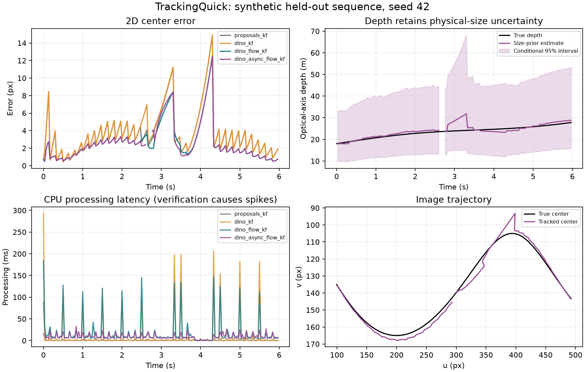
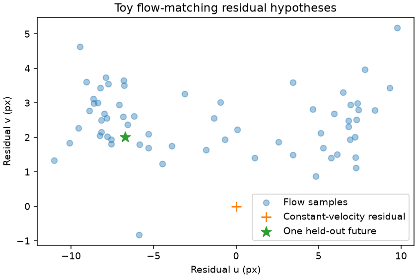

# TrackingQuick research report

SPAICE single-drone tracking | Quick research prototype v0.1 | 28 October 2026

DINOv2 appearance verification, Kalman filtering, a conditional distance estimate, and a small flow-matching experiment. All measured vision results below use original synthetic imagery on the laptop CPU. This report does not establish accuracy or real-time performance on flying drones in real footage.

## 1. System design and implementation

| Component | What ran |
| --- | --- |
| Appearance | Frozen DINOv2-small INT8; 112 px crops; positive/negative prototype score |
| 2D tracking | Timestamped constant-velocity Kalman filter; gated observations; short-gap prediction |
| Point tracking | Pyramidal Lucas-Kanade flow with forward/backward and photometric checks |
| Distance | Apparent width plus an uncertain physical-size prior, carried through a separate Kalman filter |
| Flow matching | Small conditional residual-motion model trained and evaluated on generated trajectories |
| Research only | Drone-trained YOLO, TAPNext, learned metric depth, and full stereo image correspondence |

For deployment, use synchronized global-shutter stereo RGB cameras. Calibrate intrinsics, distortion, stereo pose, baseline and timestamp offset. Select optics from target pixel size and field of view; select baseline from depth uncertainty at the required range. A narrow view helps small drones but increases reacquisition difficulty. No operating-range claim is supported by this prototype.

A fixed camera permits simple image-motion filtering. A gimbal requires timestamped pose compensation and uncertainty for its moving optical center. A full 3D filter should maintain position and velocity in a stable frame and transform results back into the requested camera frame. Camera convention here is x-right, y-down, z-forward.

The current dark-object proposal generator is intentionally limited to the synthetic sky. YOLO remains the intended trained detector replacement. DINO supplies crop features; it does not supply independent bounding boxes or establish physical object size. [1,2,9]

## 2. Measured detection and tracking

Two 180-frame clips (seeds 42 and 73), 640 x 360 at 30 source Hz; 165 visible frames per clip. Prototype references: 16 training crops and 12 validation crops, separate seeds. The renderer is shared across splits. Hardware: AMD Ryzen 5 4500U, about 8 GB RAM, Windows; CPU inference with two ONNX threads. The machine's background load was uncontrolled.

| Mode | Seed | RMSE px | Coverage | p50 ms | p95 ms |
| --- | --- | --- | --- | --- | --- |
| Proposals + KF | 42 | 3.71 | 100.0% | 0.21 | 3.59 |
| DINO + KF | 42 | 3.83 | 100.0% | 0.25 | 97.04 |
| DINO + flow + KF | 42 | 2.71 | 100.0% | 6.83 | 114.97 |
| DINO async + flow + KF | 42 | 2.76 | 97.0% | 7.08 | 22.10 |
| Proposals + KF | 73 | 2.99 | 100.0% | 0.22 | 3.70 |
| DINO + KF | 73 | 3.41 | 100.0% | 0.22 | 114.16 |
| DINO + flow + KF | 73 | 2.09 | 100.0% | 6.66 | 113.95 |
| DINO async + flow + KF | 73 | 1.73 | 81.8% | 6.08 | 24.01 |

Timing is main-thread processing only, including CPU contention from the background verifier but excluding camera acquisition, encoding and replay waits. It is not capture-to-display latency. Async RMSE excludes tentative frames, so its lower error cannot be compared directly without the coverage column. The easy clips show no accuracy benefit from DINO over the proposal baseline; point flow reduces between-detection error.

Async first-confirmed output occurred after approximately 0.169 s / 0.190 s of wall time. Maximum replay lateness was 128.0 ms / 12.9 ms. A camera deployment needs a latest-frame capture policy and a measured deadline budget; this replay preserves every frame.

## 3. Filtering, scale and triangulation

Image state is [u,v,du/dt,dv/dt]. Prediction uses the source time delta and acceleration noise; association uses the innovation covariance and a Mahalanobis gate. The covariance correction uses the Joseph form. Missed observations increase uncertainty. Tracks are tentative, detected, flow-updated, predicted or lost; a one-second absence of direct detection retires the track. Flow noise grows with age, but cross-frame correlation is only approximated.

For an apparent width p and calibrated focal length f, Z=fW/p requires a physical projected width W. The range state is [q,q_rate,L], where q=log(Z/W) and L=log(W). Width observations measure q=log(f/p), never L. The median depth is exp(q+L). A fixed 0.30 log-size standard deviation survives repeated observations, preventing false certainty about scale. Only fresh detector widths update this filter.

The synthetic drone is 0.6 m wide and the default prior matches it. Changing only that assumption gives the following sensitivity on seed 42. These small nominal errors are not evidence that DINO measures metric depth. Rotation, occlusion, bounding-box definition, blur and unknown intrinsics can dominate in real footage.

| Assumed physical width | Mean absolute relative depth error |
| --- | --- |
| 0.4 m | 30.9% |
| 0.6 m | 4.7% |
| 0.9 m | 55.4% |

### Stereo alternative

Rectified stereo gives Z=fB/d and approximately sigma_Z=sqrt(2)*sigma_px*Z^2/(fB). The implemented geometry routine checks disparity and epipolar consistency and propagates pixel uncertainty into XYZ. Below is an analytic illustration with f=900 px, B=1 m and independent 1 px localization error. Calibration and synchronization errors are excluded.

| Depth | 1-sigma depth uncertainty |
| --- | --- |
| 20 m | 0.63 m |
| 50 m | 3.93 m |
| 100 m | 15.71 m |
| 200 m | 62.85 m |

The rapid growth explains why long-range stereo needs suitable optics, baseline and correspondence precision. Bounding-box centers across views may not correspond to the same physical point. Poor stereo should trigger bearing-only tracking and growing depth uncertainty. The full 3D tracker and image correspondence pipeline remain proposed work.

## 4. Flow matching, point models and robustness

The flow-matching toy learns residual displacement after constant-velocity prediction. Its input conditions contain motion and gap duration; there are no camera features. The objective predicts x1-x0 at the interpolated state (1-t)x0+t*x1. A small NumPy network draws 64 hypotheses with 16 Euler steps. Evaluation uses 150 independent generated cases. This is not a reproduction of GenPT. [5,6]

| Motion experiment | Measured result |
| --- | --- |
| Constant-velocity residual RMSE | 7.21 px |
| Flow sample-mean RMSE | 6.40 px |
| Nominal 95% marginal interval coverage | 88.3% |
| Batched sample generation per case | 6.01 ms (not single-request latency) |

The mean improves on this constructed motion task, but intervals under-cover. Keep the generated futures out of the measurement update. A later experiment could compare calibrated motion priors or mixtures against a constant-velocity model; generated samples are not independent sensor evidence.

'NextTap' was interpreted as TAPNext: a causal point tracker with official implementations. It was researched but not installed or timed here. The next test would replace Lucas-Kanade, seed stable body points rather than spinning propellers, honor visibility scores, and audit resize/coordinate transforms. Published GPU timing does not establish CPU latency. [3,7]

'ScaleGPT' did not resolve to a reliable primary source. ScaleDepth is a related identifiable scale/relative-depth method; it was not run. A learned scale model needs a real drone-domain test. [4]

## 5. Failure modes, delivery and next experiment

Small augmentation: reference brightness, size and modest orientation variation, plus three-pixel blur on a subset. Test clips add a lighting change, five-pixel blur and a fifteen-frame full occlusion. Failure modes remain dark-background proposals, appearance shift, motion blur, drift onto an occluder, delayed verification and size-prior bias. Short exposure helps blur but increases low-light noise.

For a fuller system, radar can add range/range-rate, thermal can improve night visibility, and gimbal IMU/encoders can support motion compensation. Fuse timestamped observations in a common frame with sensor-specific observation functions and covariances; avoid counting correlated camera-derived estimates twice.

The public multiview drone dataset is a candidate for the next test. Its dataset-1 labels are drone centers, not boxes, and the repository uses CC BY-NC-SA 4.0. No external footage or derived images were downloaded in this run. Confirm terms and annotation suitability, then split complete flights before fitting any model or threshold. [8]

The next smallest useful step is one licensed real drone clip, a flight-level split, and a drone-trained detector. Test DINO verification against birds and missed detections, then consider TAPNext if point drift is a measured limitation. Actual metric validation needs calibrated stereo or independently measured object dimensions.

### Reproduce and inspect

Run: uv sync --locked --extra research; uv run python scripts/fetch_dino.py; uv run pytest -q; uv run trackingquick; uv run python scripts/build_report.py. The artifact download is 24.4 MB, CPU-only and SHA-256 checked. No cloud compute or API credentials were used. Six targeted tests cover motion prediction, missing-frame uncertainty, outliers, persistent scale ambiguity, stereo checks, featureless flow and stale async verdicts.

The initial 224 px crop run is retained in reports/baseline224. Its median DINO crop time was 493.6 ms; the final 112 px run measured 108.0 ms. This is a practical ablation on a loaded laptop, not a controlled hardware speedup claim. Raw per-frame CSV, metrics JSON, figures and a locally generated annotated video accompany the implementation.

### Primary sources

1. [DINOv2: source and original backbone](https://github.com/facebookresearch/dinov2)
2. [DINOv2-small ONNX export used here](https://huggingface.co/onnx-community/dinov2-small)
3. [TAPNext: original project and evaluation](https://tap-next.github.io/)
4. [ScaleDepth: scale and relative depth](https://github.com/RuijieZhu94/ScaleDepth)
5. [GenPT: Generative Point Tracking with Flow Matching](https://arxiv.org/abs/2510.20951)
6. [Flow Matching Guide and Code](https://arxiv.org/abs/2412.06264)
7. [OpenCV: optical flow](https://docs.opencv.org/4.x/d4/dee/tutorial_optical_flow.html)
8. [Candidate multiview drone dataset](https://github.com/CenekAlbl/drone-tracking-datasets)
9. [YOLO detection documentation](https://docs.ultralytics.com/tasks/detect/)